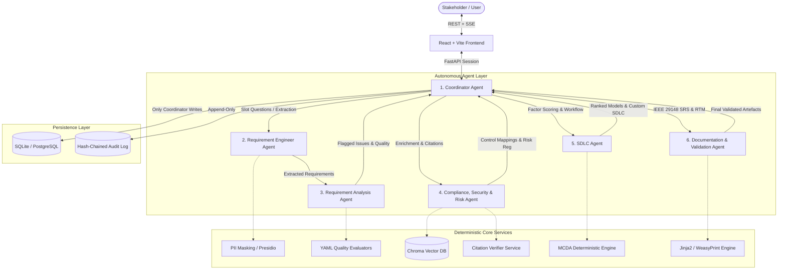
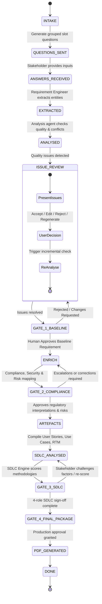
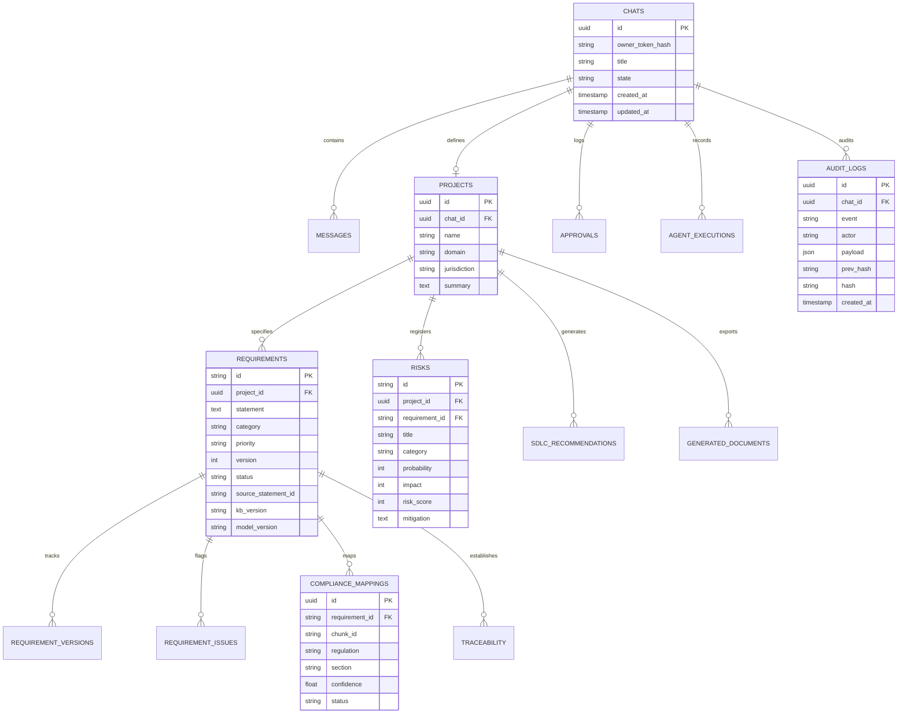

# System Architecture Specification

## 1. Executive Summary & Purpose
The **AI Requirement Engineer (FinReq)** is an institutional-grade, multi-agent AI system designed for requirements elicitation, analysis, compliance mapping, and SDLC methodology identification in the financial services sector.

The system is strictly designed with an **Offline Open-Weights LLM Policy**, meaning no sensitive financial data or proprietary prompts ever leave the local deployment environment.

---

## 2. Multi-Agent Orchestration Architecture

The system consolidates the 13 functional roles outlined in the Problem Statement into **6 specialized agents** coordinated via a LangGraph state machine:

### Agent Roles & Problem Statement Absorption Matrix
| Primary Agent | Absorbed Problem Statement Roles | Core Responsibilities |
|---|---|---|
| **1. Coordinator** | Orchestrator, Human-Approval Agent, Session Gateway | Routes messages, manages state machine transitions, controls approval gates, records audit hashes. **Only agent permitted to write to the DB.** |
| **2. Requirement Engineer** | Stakeholder Interaction, Elicitation, Extraction, Clarification | Generates slot-targeted question sets, role-based interviews, parses multi-modal inputs (text, docs, transcripts), links `source_statement_id`. |
| **3. Requirement Analysis** | Multi-label Classification, Ambiguity Detection, Conflict & Duplication | Applies 10 quality checks (INCOSE/ISO 29148), classifies across 13 requirement categories, detects contradictions, proposes measurable rewrites with rationale. |
| **4. Compliance, Security & Risk** | Compliance Analysis, Security & Privacy Controls, Risk Assessment | Queries versioned regulatory KB, retrieves evidence chunks, maps obligations, executes deterministic compliance rules, builds 5x5 risk register. |
| **5. SDLC Selection** | SDLC Methodology Assessment, Life-Cycle Modeler | Evaluates 13 financial and architectural factors using deterministic MCDA rules, produces ranked % fit, generates 10-dimension phase workflow. |
| **6. Documentation & Validation** | SRS Compilation, Traceability Matrix (RTM), Acceptance Criteria | Synthesizes IEEE 29148 SRS, links end-to-end traceability, renders downloadable PDF (watermarked DRAFT unless approved). |

---

## 3. Conversation State Machine

The Coordinator enforces a strict state machine with human-in-the-loop approval interrupts:

---

## 4. Entity-Relationship Data Model (ERD)

---

## 5. Security & Permission Architecture

### 5.1 Agent Least-Privilege Permission Matrix
| Agent Name | Allowed Read Scopes | Allowed Write Scopes | DB Direct Access | External Tool Access |
|---|---|---|---|---|
| **Coordinator** | All Session State, DB, Audit Log | All Session State, DB, Audit Log | **YES (Exclusive)** | None |
| **Requirement Engineer** | Chat Inputs, Masked Uploads, Slots | Extracted Requirements (in-memory) | **NO** | Presidio Masking Service |
| **Requirement Analysis** | Extracted Requirements, Quality Rules | Flagged Issues, Suggestions (in-memory) | **NO** | Rule Engine |
| **Compliance & Risk** | Requirements, KB Chroma Chunks, Rules | Compliance Mappings, Risk Items (in-memory) | **NO** | ChromaDB Read, Verifier |
| **SDLC Agent** | Project Scope, 13 SDLC Factors | SDLC Fit Scores, Workflow Steps (in-memory) | **NO** | MCDA Scoring Engine |
| **Documentation Agent**| Approved Requirements, Mappings, Risks | SRS HTML, WeasyPrint PDF, RTM (in-memory)| **NO** | WeasyPrint Renderer |

### 5.2 Mandatory Security Guardrails
1. **Never Send Raw PII to LLM**: Presidio + custom Indian recognizers replace identifiers with deterministic vault tokens (`<PAN_1>`, `<AADHAAR_1>`) before model invocation.
2. **Offline LLM Gateway**: The gateway enforces base URL validation, immediately aborting if an external endpoint or non-allowlisted local address is queried.
3. **No Unverified Regulatory Claims**: An agent output referencing regulatory directives must pass the `CitationVerifier` against the ingested Chroma store chunks; failing this, it is marked as `needs_review` and escalated.
4. **Append-Only Tamper-Evident Audit Chain**: Every transaction computes SHA-256 over `(prev_hash, timestamp, event, payload)` ensuring cryptographic non-repudiation.

---

## 6. Problem Statement Coverage Matrix (§1–§20)

| PS § | Requirement Summary | Architectural Component | Implementation Phase |
|---|---|---|---|
| **Intro** | Agentic multi-agent LLM system, hallucination, explainability, bias, prompt injection, human oversight | Full system architecture, Guardrails, Citations, Explainability | Phases 0, 3, 9, 13, 16 |
| **§1** | System scope (onboarding/KYC, loan origination, UPI, analytics) + expected outputs (SRS, RTM, SDLC) | `Requirement`, `Project`, Scope doc, Document Generator | Phases 1, 6, 14 |
| **§2** | Stakeholders & role-specific interview templates | `agents/templates/interviews/*.yaml`, Role Switcher | Phase 6 |
| **§3** | Multi-format input processing (text, docx, pdf, emails), PII classification & masking | `core/parsers/`, `core/security/masking.py` (Presidio) | Phases 3, 6 |
| **§4** | Multi-agent architecture with centralized coordinator | 6-agent LangGraph workflow (`graph/workflow.py`) | Phase 9 |
| **§5** | Versioned financial knowledge base (RBI, PMLA, DPDP, ISO 27001) | `kb/manifest.yaml`, ChromaDB persistent collections | Phase 7 |
| **§6** | RAG pipeline: retrieval, citation verification, confidence scoring, human escalation | `rag/retriever.py`, `rag/verifier.py` | Phases 7, 10 |
| **§7** | Adaptive, slot-based clarification interviews | `rules/slots.yaml`, `agents/requirement_engineer.py` | Phase 6 |
| **§8** | Canonical requirement structure (PS §8 attributes + versioning + evidence) | `backend/app/schemas/requirement.py` | Phase 1 |
| **§9** | Multi-label requirement classification (13 categories) | `agents/analysis.py`, fine-tuned LoRA classifier | Phases 4, 5, 6 |
| **§10** | Quality analysis (10 checks: ambiguity, conflicts, testability, weak words) | `rules/quality_rules.yaml`, `agents/analysis.py` | Phase 8 |
| **§11** | Compliance, privacy, and security analysis without final legal determination disclaimer | `agents/compliance_security_risk.py`, YAML rules | Phase 10 |
| **§12** | Complete documentation suite (SRS, Stories, Use Cases, RTM, Risk Register) | `agents/documentation.py`, `docs_gen/` | Phase 14 |
| **§13–14**| 13 SDLC decision factors, deterministic scoring table, ranked recommendations | `rules/sdlc_engine.py`, `rules/sdlc_rules.yaml` | Phase 11 |
| **§15** | Customized project-specific SDLC lifecycle workflow | `agents/sdlc.py`, `rules/workflow_templates/` | Phase 11 |
| **§16** | 8 mandatory human-in-the-loop approval gates | `graph/gates.py`, `backend/app/schemas/approval.py` | Phase 12 |
| **§17** | Security controls (injection defense, RBAC/MFA design, encryption at rest, audit trail) | `core/security/`, `core/audit.py`, `core/crypto.py` | Phases 3, 7, 13 |
| **§18** | Prototype tech stack validation (FastAPI, React, SQLite, Chroma, Ollama) | Core repository stack | Phases 2–16 |
| **§19** | Evaluation metrics (P/R/F1, ambiguity recall, SDLC accuracy, time saved) | `ml/eval/`, `ml/eval/run_eval.py` | Phase 15 |
| **§20** | Advisory mode deployment, auditability, monitoring, regression testing | Docker Compose, Advisory banners, runbooks | Phase 17 |
